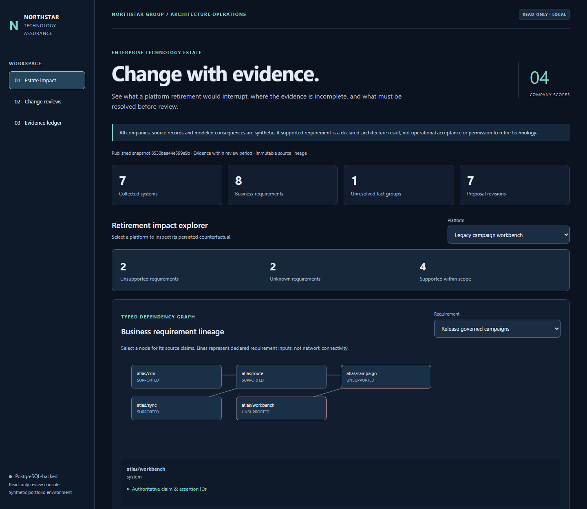
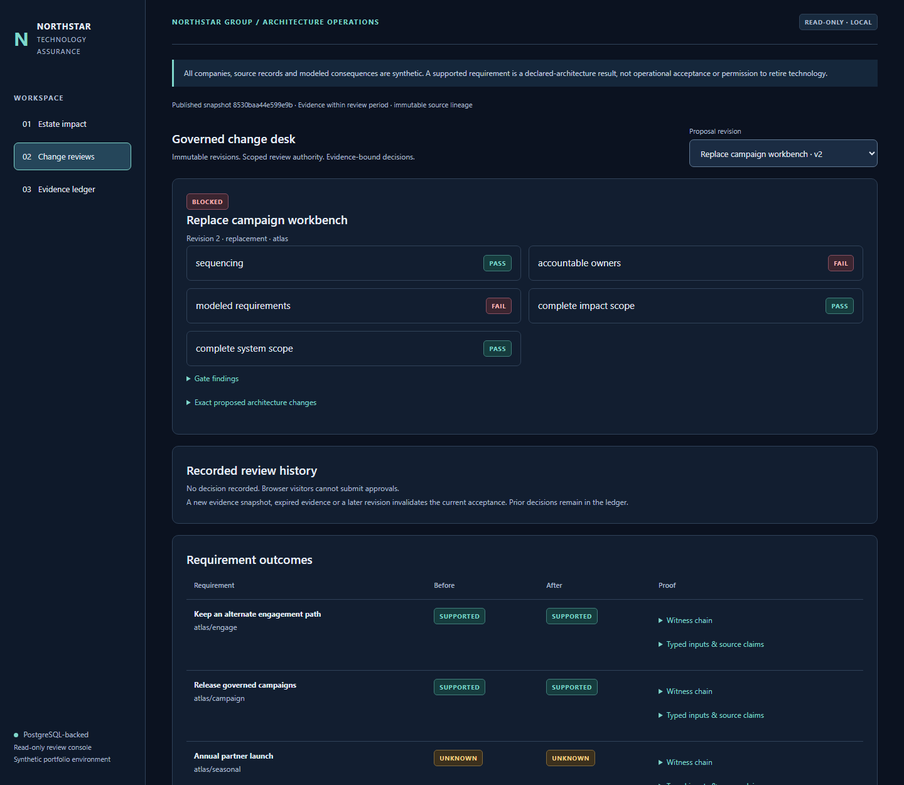
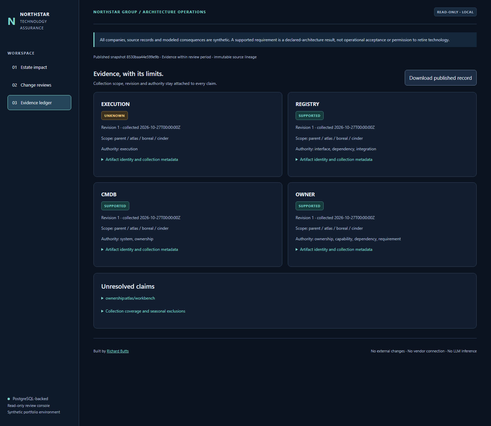

# Observed change-assurance acceptance

The records below come from actual local PostgreSQL and Chromium execution over synthetic company evidence. They are separate from the [original estate verification](../verification.json), whose bytes and claim boundaries remain unchanged.

## Native execution

- **70 original tests and 38 additive tests**, zero failures, errors or skips.
- Original bounded graph oracle retained: **350 generated graph comparisons** within the original suite.
- **112 requirement outcomes** independently reconciled across the multi-company baseline and 13 displayed proposal/retirement revisions.
- **144 browser checks**, five viewport widths, eight automated accessibility states with no unresolved findings.
- Six genuine screenshots captured from the running SELECT-only console.
- Original demonstration regenerated twice byte-for-byte in fresh output directories; built-wheel code, SQL and browser assets compared to repository bytes.
- **95 original files** remain byte-identical to main revision `6bc3e253540dfe38cb5ae58cf00038dab31f7024`, including the original engine, tests, oracle, fixtures, reports, historical evidence and protected walkthrough.

The source fingerprints in the execution and browser records bind the actual implementation. `scripts/check_change.py` rejects mismatched source hashes, screenshot bytes, original bytes or current package inventory. GitHub Actions reruns the checks independently; consult the exact pull-request head for hosted status rather than treating this local record as CI evidence.

| Artifact | Inspect |
|---|---|
| Native environment, exact cases and source hashes | [verification.json](run-01/verification.json) |
| Baseline / counterfactual independent results | [oracle-comparison.json](run-01/oracle-comparison.json) |
| Published source, assessments, gates and actual decisions | [estate-record.json](run-01/estate-record.json) |
| Browser interactions, accessibility and screenshot provenance | [browser.json](run-01/browser/browser.json) |
| Actual wheel member comparison | [wheel.json](run-01/wheel.json) |
| Fresh original demonstration | [estate overview](run-01/original-demo/estate-overview.md) |
| Original protection inventory | [preserved-original.json](preserved-original.json) |
| Current public package inventory | [package-manifest.json](package-manifest.json) |

## Captured console

Mobile captures: [retirement impact](run-01/browser/estate-mobile.png), [change review](run-01/browser/changes-mobile.png), [evidence](run-01/browser/evidence-mobile.png).

## Failures deliberately preserved in the model

Retiring the Atlas workbench breaks campaign requirements. The first replacement lacks a required interface field. The second repairs the interface but retains the owner dispute and seasonal gap. Annual inactivity is not established by zero observations in a partial window. Unanchored cycles remain Unknown. Consolidation and shared-service outage expose cross-company consequences. An accepted scoped capability reassignment does not erase the rejected or blocked proposals.

Negative tests establish rejected cross-company leakage, omitted impact scope, unauthorized source assertions, wrong dependency direction, stale evidence, missing acceptance evidence, concurrent revision conflicts, unauthorized/direct decision writes, revoked review authority and immutable-history mutation. Real child processes exit before each publication commit; PostgreSQL rolls back the incomplete pointer/version and permits a safe retry.

This evidence establishes finite local architecture analysis, governance and recovery behavior. It does not establish a real enterprise deployment, operational cutover acceptance, vendor certification, savings, runtime service availability or business results. Docker execution is a separate Linux CI lane; no local Docker execution is claimed by the Windows record.

[Reproduction instructions](../../change-assurance-operations.md) · [Validation design and limits](../../change-assurance-validation.md)
